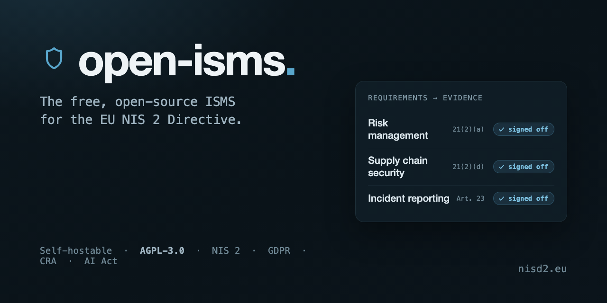

<p align="center">
  
</p>

<p align="center">
  <a href="https://github.com/NISD2/open-isms/tags"></a>
  <a href="https://github.com/NISD2/open-isms/pkgs/container/open-isms"></a>
  <a href="https://github.com/NISD2/open-isms/actions/workflows/ci.yml"></a>
  <a href="LICENSE"></a>
</p>

<p align="center">
  <a href="https://www.nisd2.eu"><b>nisd2.eu</b></a> ·
  <a href="https://www.nisd2.eu/docs"><b>Documentation</b></a> ·
  <a href="https://www.nisd2.eu/docs/getting-started/quickstart"><b>Self-host in one command</b></a>
</p>

---

# NIS 2, done step by step

You were handed NIS 2 and don't know where to start. open-isms walks your company through it
one item at a time: it explains each duty in plain words, asks only what that duty needs, and
writes the documents from your answers. At the end, management reviews and approves everything
in the app, with name and date on record.

It is the platform behind [nisd2.eu](https://www.nisd2.eu), open source under AGPL-3.0, and you
can run the same thing on your own server.

## What your company ends up with

- **A guided walkthrough** of the NIS 2 duties, in German, English and Czech. Each step says why
  it applies, shows what good looks like where that helps, and lets you set a step aside when it
  cannot be done yet.
- **Documents written from your answers:** the security policy, the incident plan and the others,
  ready for management to approve. No templates to fill in by hand.
- **Your registers, kept in one place:** assets, suppliers, risks, trainings, management reviews,
  each linked to the requirement it proves.
- **Approvals that count as evidence.** Every sign-off is stored with who approved what and when,
  so the record builds up as you work instead of the week before an audit.
- **A supplier questionnaire** your suppliers answer in their own portal, instead of a spreadsheet
  sent around by email.
- **A GDPR walkthrough** for the controller duties most companies have: the data protection
  officer, the record of processing activities, processors and their agreements, breaches and
  requests from data subjects.
- **Your own AI assistant can help.** Connect it over MCP and it fills in the walkthrough for you.
  It never signs: approvals stay with people.

The interface speaks ten EU languages.

## Two ways to use it

**Hosted, on [nisd2.eu](https://www.nisd2.eu).** Sign up and start with your registration; the
first steps are free.

**On your own server.** One command checks Docker, generates the secrets, starts the stack and
loads the framework data:

```bash
curl -fsSL https://raw.githubusercontent.com/NISD2/open-isms/main/install.sh | bash
# then open http://localhost:3026
```

Rather read the script first, or set it up by hand? The
[installation guide](https://www.nisd2.eu/docs/self-hosting/installation) covers both, plus TLS,
email, storage, backups and updates.

The published image is the compliance app. The public site, the wiki, the docs, the courses and
the supplier portal run at nisd2.eu, and the app links to them there. Their source is in this
repository too.

## For developers

The framework data is on npm, so you can build on it without running the platform:

| Package | What it gives you |
|---|---|
| [`@nisd2/grc-data-model`](https://www.npmjs.com/package/@nisd2/grc-data-model) | 219 requirements across NIS 2, GDPR, the EU AI Act, the CRA and ISO 27001:2022, with the links between them, and Drizzle schemas for Postgres |
| [`@nisd2/incident-notification-schema`](https://www.npmjs.com/package/@nisd2/incident-notification-schema) | The NIS 2 Article 23 incident notification as a typed Zod schema |
| [`@nisd2/nis2-supply-chain-questionnaire-schema`](https://www.npmjs.com/package/@nisd2/nis2-supply-chain-questionnaire-schema) | The questions a regulated company asks its suppliers, as Zod and JSON Schema |

Every instance serves an MCP endpoint at `/api/mcp`, off until a company admin turns it on:

```bash
claude mcp add --transport http nisd2 https://isms.example.com/api/mcp
```

## Documentation

Everything else lives at **[nisd2.eu/docs](https://www.nisd2.eu/docs)**:

- [Quickstart](https://www.nisd2.eu/docs/getting-started/quickstart) and
  [how it works](https://www.nisd2.eu/docs/getting-started/how-it-works)
- [Self-hosting](https://www.nisd2.eu/docs/self-hosting/installation): configuration, domains and
  TLS, email, storage, backup and restore, troubleshooting
- [Connecting an AI assistant](https://www.nisd2.eu/docs/self-hosting/mcp)
- [The npm packages](https://www.nisd2.eu/docs/packages/npm-packages)
- [Contributing](https://www.nisd2.eu/docs/contributing/local-development): local development,
  project structure, tests, migrations, releases

The docs are written in [`content/docs/`](./content/docs/), so a correction is a pull request
against the same file the site shows.

## Contributing

Pull requests are welcome, especially framework mappings, translations and documentation. Start
with [CONTRIBUTING.md](./.github/CONTRIBUTING.md). To report a security issue, see
[SECURITY.md](./.github/SECURITY.md).

## License

The platform is [AGPL-3.0-or-later](./LICENSE), with one additional term under section 7(b), set
out in [NOTICE](./NOTICE): a work based on it keeps the attribution "open-isms by nisd2.eu" in the
legal notices its interface displays. The NIS 2 management course in `courses/` is
[CC BY 4.0](./courses/LICENSE): reuse it, adapt it and publish it under your own name, commercially
too, with attribution. The npm packages carry their own licenses (MIT for
`@nisd2/grc-data-model`; see each package). What the repository holds of laws and standards such
as ISO/IEC 27001 is set out in [LICENSE-DATA.md](./LICENSE-DATA.md).
